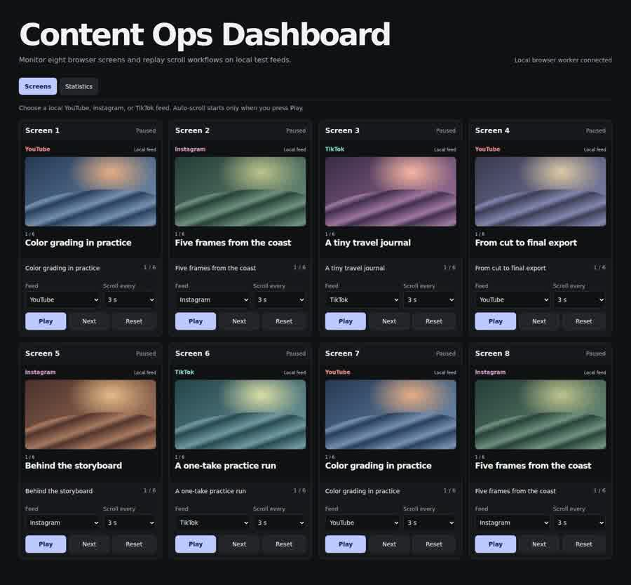

# Content Ops Dashboard

An isolated public edition of a multi-screen content-operations dashboard. Eight Chromium pages render local YouTube, Instagram, and TikTok test feeds. The dashboard shows a captured browser image for each screen, lets you step or auto-scroll it, and records what actually moved.

## Run locally

Use Node.js 24 or later and a Playwright-compatible Chromium browser.

~~~sh
npm ci
npx playwright install chromium
npm start
~~~

Open http://127.0.0.1:4175. If you already have compatible Chrome or Chromium, set `CHROME_PATH` to its executable before starting. Use `PORT` to pick a different port. The server listens on IPv4 loopback only.

Choose a feed on a screen, press **Next** to move one item, or choose a cadence and press **Play**. **Pause** stops the timer. **Reset** returns the screen to its first item without incrementing statistics. The **Statistics** tab breaks down manual and automatic scrolls by feed.

## How the screens work

- **Browser worker:** Playwright opens one Chromium session with eight separate pages. Each page renders an in-memory, scroll-snapping fixture. The worker rejects all page network requests and never navigates to real platform pages.
- **Controller:** Node serializes browser commands and scheduler ticks. It records a scroll only after the worker observes a changed page position and captures the new frame.
- **Dashboard:** The local web UI polls the worker for state and updates the screen's JPEG only when its revision changes. Statistics count local actions, not video views, engagement, or API analytics.

The public edition reuses the dashboard palette and multi-screen workflow. It does not include the live browser bridge, OAuth integrations, account sessions, proxy routing, or production server configuration. Feed controls are local; there is no public remote-control endpoint or provider login. Captured frames and statistics are kept in memory and are cleared when the process exits.

## Check the behavior

~~~sh
npm test
npm run test:browser
~~~

The first command checks the controller and HTTP boundaries with a test driver. The browser suite starts the actual server and Chromium pages and checks frame updates, feed switching, timed scrolling, pausing, statistics, and narrow screen layouts.
